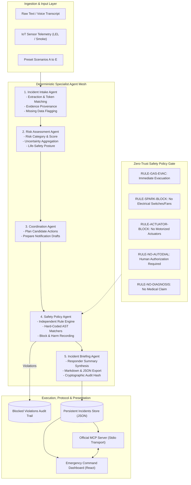
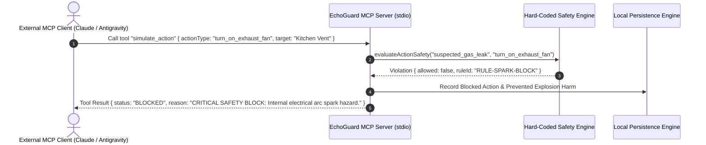

# EchoGuard MCP — Architecture & Technical Specifications

This document outlines the system architecture, component relationships, data flow, deterministic multi-agent pipeline, and safety boundaries of **EchoGuard MCP**.

---

## 1. High-Level Architecture Overview

EchoGuard MCP bridges external conversational interfaces (LLMs, voice assistants, occupants) with a **hard-coded safety governance layer** before allowing actions to reach home automation or communication interfaces.

---

## 2. Multi-Agent Pipeline Specifications

### A. Incident Intake Agent (`src/shared/agents/intake-agent.ts`)
- **Responsibility:** Ingests unformatted text reports. Identifies hazard category (`suspected_gas_leak`, `smoke_fire`, `medical_distress`, `electrical_hazard`, `benign_or_unknown`).
- **Symptom Extraction:** Uses deterministic matching for ocular burning, cephalea, nausea, dyspnea.
- **Data Provenance:** Flags evidence as `user_reported` vs. `sensor_verified`.
- **Honesty Rule:** Automatically marks missing parameters (calibrated PPM, gas meter valve status, occupant count) as **UNKNOWN** rather than guessing or hallucinating facts.

### B. Risk Assessment Agent (`src/shared/agents/risk-agent.ts`)
- **Responsibility:** Calculates severity category (`CRITICAL`, `HIGH`, `MODERATE`, `LOW`) and numeric score (0–100).
- **Rule Set:**
  - Suspected Gas Leak + Acute Symptoms (Eye burning / dizziness) $\to$ **CRITICAL** (Score 95).
  - Suspected Gas Leak alone $\to$ **HIGH** (Score 82).
  - Active Smoke / Fire $\to$ **CRITICAL** (Score 90).
  - Benign Odor $\to$ **LOW** (Score 15).
- **Transparent Disclaimer:** Emits a simulation notice clarifying that the output is not a certified industrial safety assessment.

### C. Coordination Agent (`src/shared/agents/coordination-agent.ts`)
- **Responsibility:** Formulates actionable workflows:
  - Life-safety evacuation directive.
  - Safe upwind perimeter designation (300 feet).
  - Candidate smart-home actions (including unsafe user requests for policy screening).
  - Prepares notification drafts (911 dispatch, gas utility, family contacts).

### D. Safety Policy Agent (`src/shared/agents/safety-agent.ts` & `safety-policy.ts`)
- **Responsibility:** Independent gatekeeper executing hard-coded life-safety rules.
- **Zero-Trust Rule Enforcement:** Evaluates candidate action verbs and targets against spark risks (`switch`, `fan`, `exhaust`, `breaker`, `appliance`) and physical actuators (`solenoid`, `smart_lock`, `motor_flap`).
- **Violation Logging:** Intercepts dangerous requests, mutates status to `BLOCKED`, logs rule ID, reason, and prevented catastrophe harm.

### E. Incident Briefing Agent (`src/shared/agents/briefing-agent.ts`)
- **Responsibility:** Compiles responder-ready summaries formatted in standard GitHub Markdown and JSON.
- **Audit Hash:** Computes a unique audit hash string (`EG-<hash>-<timestamp>`) for traceability across incident handoffs.

---

## 3. Official Model Context Protocol (MCP) Server Architecture

The MCP server runs in `src/mcp/index.ts` using `@modelcontextprotocol/sdk/server/mcp.js` over standard input/output (`stdio`).

### Transport & Tool Registry

---

## 4. Local Persistence & Audit Engine

- **Storage Location:** `./data/incidents.json` and `./data/audit-log.json`.
- **Concurrency & OS Resilience:** Direct atomic file write operations preventing Windows / OneDrive file handle locking errors (`EPERM`).
- **Deterministic Seeding:** Initializes default demo scenarios upon clean startup.
- **Reset Mechanism:** Supports one-click restore to pristine demonstration state.

---

## 5. Security & Isolation Controls

1. **Zero Shell Execution:** MCP server exposes zero shell commands, terminal execution, or file system write access to external agents.
2. **actuator Air-Gap:** Actuation tool calls are strictly simulated; no physical relays or smart outlets are energized.
3. **Prompt Injection Immunity:** Safety policy logic is implemented in pure compiled TypeScript AST checks, completely decoupled from LLM prompt context windows.
