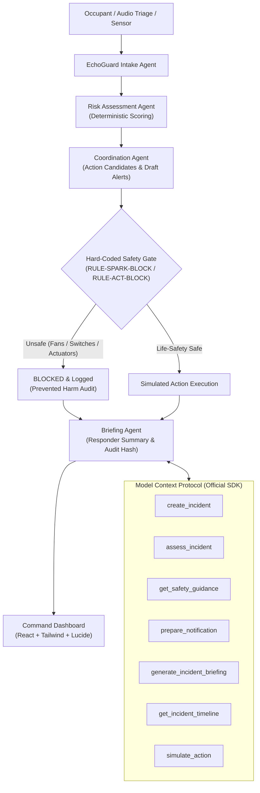

# EchoGuard MCP — Safety-Governed Emergency Intelligence

> **An MCP-based, safety-governed emergency coordination layer combining multi-agent reasoning, auditable decisions, controlled tool execution, and responder-ready incident summaries.**

[](https://www.typescriptlang.org/)
[](https://modelcontextprotocol.io/)
[](https://react.dev/)
[](https://vitejs.dev/)
[](https://vitest.dev/)
[](#safety-rules)

---

## 1. Executive Summary & Innovation Hypothesis

When an occupant reports a household hazard such as *"I smell gas and my eyes are burning"*, generic LLMs or unconstrained smart-home automations risk suggesting fatal actions:
- Flipping on an exhaust fan or light switch produces internal electrical arcs that detonate accumulated natural gas.
- Auto-dialing emergency dispatches on hallucinatory inferences wastes critical municipal resources.
- Hallucinating sensor ppm numbers creates a false sense of security.

**EchoGuard MCP** addresses this life-safety challenge through an independent, deterministic emergency coordination layer:
1. **Evacuation-First Doctrine:** Immediately mandates evacuation on foot before triage or sensor analysis.
2. **Hard-Coded Safety Gate:** Zero-trust policy engine that screens and blocks all spark-inducing tool calls (exhaust fans, switches, circuit breakers) and physical actuator triggers (motorized valves, smart deadbolts).
3. **Honest Data Provenance:** Strictly distinguishes user-reported claims from verified IoT sensor telemetry, explicitly marking unknowns rather than hallucinating facts.
4. **Official MCP Tool Suite:** Exposes 7 validated tools, read-only resources, and prompt templates using the official `@modelcontextprotocol/sdk`.
5. **Responder-Ready Briefings:** Synthesizes structured markdown and JSON incident summaries with cryptographic audit hashes for first responders.

---

## 2. System Architecture



---

## 3. Technology Stack

- **Runtime & Language:** Node.js (v20+ / v24+), TypeScript (`ES2022`, strict typing).
- **Model Context Protocol:** Official `@modelcontextprotocol/sdk` (v1.32+).
- **Validation:** Zod runtime schema validation for all tool inputs, outputs, and HTTP endpoints.
- **Backend API:** Express with CORS, health diagnostics, and SPA static hosting.
- **Frontend Dashboard:** React 19, Vite, Tailwind CSS v4, Lucide React icons.
- **Testing:** Vitest (35 comprehensive unit, integration, and E2E tests).
- **Local Persistence:** Structured JSON database with atomic writes and tamper-evident audit logs.

---

## 4. Quick Start & Launch Guide

### Prerequisites
- Node.js v20+ or v24+ installed
- Windows PowerShell, macOS, or Linux terminal

### 1. Install Dependencies
```powershell
npm install
```

### 2. Run All Tests
```powershell
npm test
```
*Expected: 35 tests passing across 5 test files with 0 failures.*

### 3. Build Production Bundle
```powershell
npm run build
```

### 4. Start the Application

You can run the full-stack server (serving both the backend API and frontend dashboard) with a single command:

```powershell
npm run server
```

- **Emergency Command Dashboard:** Open [http://localhost:3001](http://localhost:3001) in your browser.
- **Backend API Base:** [http://localhost:3001/api](http://localhost:3001/api)
- **Health Check:** [http://localhost:3001/api/health](http://localhost:3001/api/health)

*(Optional for frontend developers: run `npm run dev` to launch Vite on `http://localhost:5173` with hot-module reload and automatic `/api` proxying to port 3001).*

---

## 5. Connecting an MCP Client

EchoGuard MCP is a compliant MCP server runnable via standard I/O (`stdio`).

### Running the MCP Server Standalone
```powershell
npm run mcp
```

### Configuration for Claude Desktop / Cursor / Antigravity
Add the following block to your MCP settings file (e.g., `%APPDATA%\Claude\claude_desktop_config.json`):

```json
{
  "mcpServers": {
    "echoguard": {
      "command": "npx",
      "args": ["tsx", "src/mcp/index.ts"],
      "cwd": "c:\\Users\\arrua\\OneDrive\\ECHOGUARD MCP",
      "env": {
        "DEMO_MODE": "true",
        "MCP_TRANSPORT": "stdio"
      }
    }
  }
}
```

### Available MCP Tools
| Tool | Description |
|------|-------------|
| `create_incident` | Ingests report, coordinates 5 agents, enforces safety policies. |
| `assess_incident` | Returns deterministic risk score, factors, and uncertainties. |
| `get_safety_guidance` | Hard-coded evacuation instructions and spark prohibitions. |
| `prepare_notification` | Formulates draft dispatch with mandatory human approval guardrail. |
| `generate_incident_briefing` | Synthesizes responder-ready Markdown or JSON briefing. |
| `get_incident_timeline` | Returns chronological multi-agent decision and audit events. |
| `simulate_action` | Tests candidate actions; strictly blocks spark & actuator hazards. |

### MCP Resources & Prompts
- **Resources:**
  - `echoguard://safety-policies` (Immutable safety rules)
  - `echoguard://incidents/recent` (Recent triage records)
  - `echoguard://audit-log` (Chronological audit stream)
- **Prompts:**
  - `emergency-triage` (Evacuation-first guidance for LLM assistants)
  - `safety-audit` (Interception prompts for spark hazards)

---

## 6. Demonstration Scenarios

1. **Scenario A (Suspected Gas Leak with Burning Eyes):**
   - High-severity mercaptan report in kitchen.
   - Triggers `CRITICAL` risk classification (Score 95/100).
   - Issues mandatory evacuation directive, 300ft safe assembly perimeter, and prohibits all electrical switches/fans.
2. **Scenario B (Smoke & Structure Fire):**
   - Active combustion report in utility closet with beeping detector.
   - Evaluates fire spread risks and feel-door-heat guidance.
3. **Scenario C (Benign Cleaning Odor):**
   - Vinegar smell on dining room table.
   - Classifies as `LOW` risk without panic or evacuation orders.
4. **Scenario D (Dangerous Automation Request — Spark Hazard):**
   - User or rogue agent requests turning on basement exhaust fan and floodlights during gas leak.
   - Hard-coded rules `RULE-SPARK-BLOCK` and `RULE-ACTUATOR-BLOCK` intercept and block all 3 requests, logging prevented explosion harms.
5. **Scenario E (Missing / Conflicting Evidence):**
   - Second-hand vague hallway report with zero sensor confirmation.
   - System highlights uncertainty instead of inventing facts.

---

## 7. Mandatory Disclosures & Prototype Limitations

- **Prototype Disclaimer:** EchoGuard MCP is an engineering concept prototype for hackathon demonstration. It is **NOT** a certified life-safety device (UL 1484, NFPA 54, EN 50194).
- **Physical Isolation:** Does not control live high-voltage relays or physical actuators. All actuation is simulation-only.
- **Non-Autonomous 911 Dispatch:** Previews notifications but requires verified human transmission to prevent automated swatting.
- **No Medical Diagnosis:** Symptoms are evaluated strictly as triage indicators.
